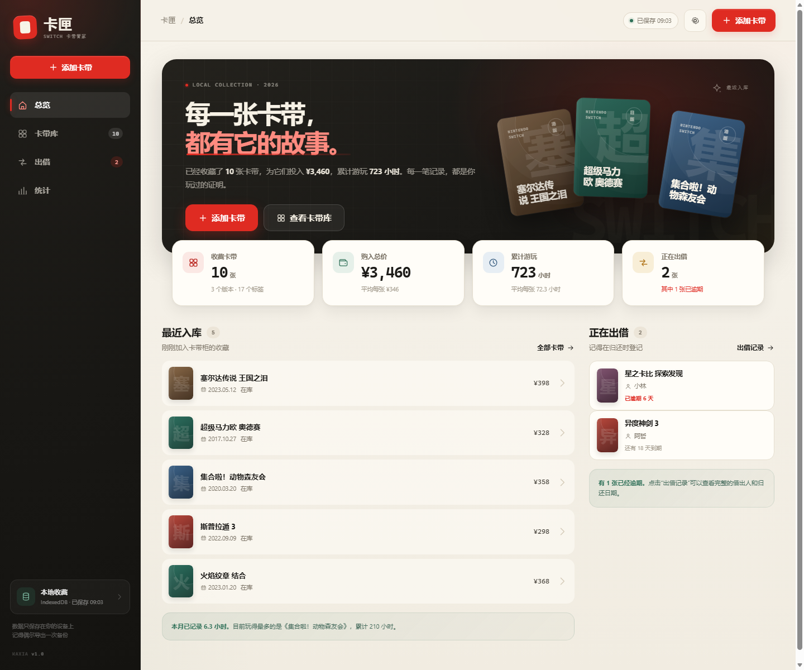
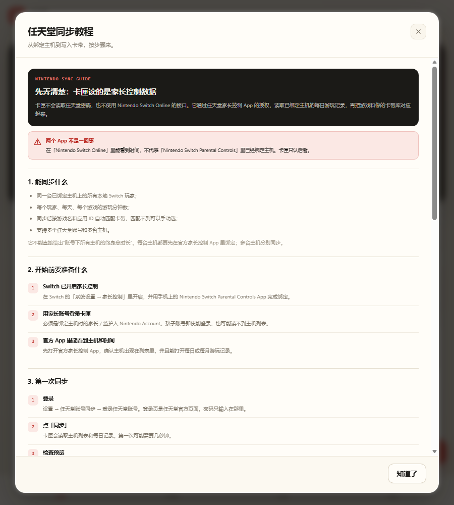
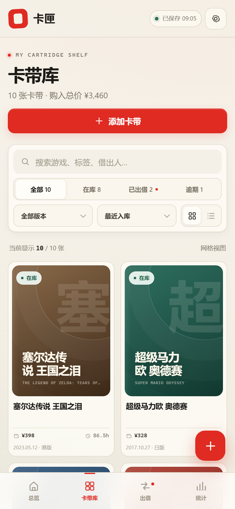

# 卡匣 · Switch 卡带管家

一个中文、移动端优先的 **Nintendo Switch 卡带收藏管理 App**。

提供两种形态：

- **Android APK**：直接安装到安卓手机，完全离线，不需要浏览器。
- **PWA / Web**：浏览器打开，也可以“添加到主屏幕”。

记录每张卡带的购入时间、价格、游玩时长和出借历史。  
**1.3.11**：设置里的「同步 / 合并」点击后主动搜索电脑、重新读取最新数据，再打开对比面板。

**1.3.5**：网页版改为直接读写电脑服务，不再作为独立同步客户端；自动上传支持每天定时和连接后自动；修复版本检查旧服务 404 的提示。

**1.3.2**：修复卡带库搜索框：输入即筛选，回车提交并收起键盘。

**1.3.1**：任天堂同步接口更新到官方 2.7.0 / 740，修复 2026-11-19 官方 App 更新后出现的 <code>update_required</code> 同步报错；错误信息也会显示具体原因。

**1.3.0**：新增「卡带编号」识别，可按 LA / LN / LB / LP 编号或 HAC-008 自动判断 NS1 / NS2 支持；新增 NS2 Edition 卡带类型。

## 直接安装 APK

安装包：

**[卡匣-1.3.11.apk](https://github.com/XiaoHongzhe/kaxia/releases/tag/v1.3.11)**（约 47.8 MB，内置离线 OCR 模型）

1. 用数据线、微信文件传输或其他方式，把 APK 传到安卓手机；
2. 在手机上点开 APK；
3. 如果系统提示“禁止安装未知来源应用”，允许当前文件管理器 / 浏览器安装；
4. 安装完成后，桌面会出现红色“卡匣”图标。

安装要求：**Android 7.0 及以上**。  
这是个人签名版本，不是应用商店包；系统可能提示“未知开发者”，确认继续即可。

SHA-256：

~~~text
0f6bda2fe8bcb382164e581a02ab9f20d47507947444c0851e933f8adb48cbd2
~~~

首次打开是空白卡带库，可以点「先看看示例」载入 10 张演示卡带。

安装步骤、覆盖升级和校验信息：[安装说明](dist/安装说明.txt)  
版本变化：[更新日志](CHANGELOG.md) · [纯文本版](dist/更新日志.txt)

## 版本识别 / 实物图片 / 暂无归还时间

### 版本图片识别

- 在添加 / 编辑卡带时点一次「识别版本和编号」，选择卡带盒或标签照片；
- App 用设备本地的 ML Kit 识别拉丁文字，再根据地区码和分级标识判断版本：<code>HKG / HK / 香港</code> 港版、<code>JPN / CERO</code> 日版、<code>USA / ESRB</code> 美版、<code>EUR / PEGI</code> 欧版、<code>TWN / NCC / BSMI</code> 台版、<code>CHN / CHS / TENCENT</code> 国行，以及韩版、澳版、亚洲版；
- <code>CHT</code> 是繁体中文标识，港版和台版包装都可能出现。只有 <code>CHT</code> 时会同时列出港版 / 台版让你选择；如果同时识别到 <code>HKG</code> 或 <code>TWN / NCC</code>，会自动锁定对应版本。OCR 把 JPN 读成 <code>J PN</code>、HKG 读成 <code>H KG</code> 时，会先去掉空格和标点再匹配。
- 识别结果会填入版本栏，你仍可以手动修改；
- 版本栏支持手动输入，并去掉了「其他」选项；
- 识别在手机本地完成，图片不会上传。

识别只作为辅助，包装上的小字、反光和拍摄角度都会影响结果，请以卡带实物为准。没有识别出来时，会显示识别文字并提供不同版本的快捷选择。

### 用已保存的照片识别

卡带详情 →「识别照片」会直接遍历这张卡带已经保存的照片，不需要再拍一次：

- 逐张做文字识别，汇总版本和卡带编号；
- 使用出现次数最多的版本 / 编号；
- 自动更新版本、卡带编号、平台支持和卡带类型；
- 没有保存照片会报错；
- 所有照片都读不出文字，或都识别不到版本/编号，也会报错；
- 识别在手机本地完成，照片不会上传。

### 卡带实物图片

- 每张卡带最多保存 **12 张**实物图片；
- 标签：卡带盒、正面、背面、侧面、划痕、其他；
- 适合记录卡带盒压痕、封面折痕、卡带正反面和侧面划痕；
- 图片会压缩后保存在本机，不上传；
- JSON 备份会把照片以 base64 数据一起打包，不保存本地文件路径；CSV 不含照片；
- 入口：卡带详情 → 卡带状态 → 添加 / 管理图片。

### 平台支持

每张卡带可以标记：

- **仅 NS1**：只在 Switch 1 上使用；
- **NS1 / NS2 通用**：同时支持 Switch 1 和 Switch 2；
- **仅 NS2**：Switch 2 专用。

卡片上的平台徽章、卡带详情和 CSV 导出都会带上平台支持；卡带库顶部有「全部平台」筛选。旧数据没有这个字段时默认按「仅 NS1」处理。

### 卡带编号识别

编辑卡带时，卡带编号可以随「识别版本和编号」一次识别，也可以手动填入标签上的编号；App 会自动判断平台支持并填写「平台支持」和「卡带版本」：

| 编号开头 | 判断结果 | 平台支持 |
| --- | --- | --- |
| <code>LA</code> | NS1 实体卡 | NS1 / NS2 通用 |
| <code>LN</code> | NS2 Edition 卡 | NS1 / NS2 通用 |
| <code>LB</code> | NS2 独占实体卡 | 仅 NS2 |
| <code>LP</code> | NS2 钥匙卡 | 仅 NS2 |
| <code>HAC-008</code> | Switch 1 实体卡（卡带背面型号） | NS1 / NS2 通用 |

- 可以直接输入完整编号，例如 <code>LA-H-AVQYA-EUR</code>，也可以只输入前缀；
- 点「识别」或输入后离开输入框，会自动填写两个下拉框；识别结果下方会说明依据；
- 自动填写后仍可手动修改，手动选择优先；
- 旧卡带没有编号时不受影响，之后编辑补填即可。

编号只代表卡带类型，具体游戏能否在 Switch 2 运行仍以官方兼容性为准。

### 已售出

卡带详情 → 购入信息右侧「标记售出」：

- 记录售出日期、价格、卖给谁/渠道和备注；
- 标记后状态变为「已售出」，不再计入在库/已出借；
- 已售出卡带不能登记出借；
- 卡带库顶部有「已售出」筛选，详情里可以编辑或取消售出；
- 首页会显示已售出数量和回血金额，CSV 也包含售出字段。

### 卡带版本

每张卡带可以标记实体卡类型：

- **NS1 实体卡**；
- **NS2 实体卡**；
- **NS2 Edition 卡**（LN 编号，NS1 / NS2 通用）；
- **NS2 钥匙卡**（Game-Key Card，LP 编号）。

卡带版本会显示在卡片、详情和 CSV 中；卡带库可以按卡带版本筛选。旧数据没有这个字段时默认按「NS1 实体卡」处理。

### 重复卡带、副本标识与标签筛选

- 同名的多张卡带会在卡片上显示 `同款 ×N`；
- 每张卡带显示版本标签（如日版、港版）和可选「副本标识」（如首刷、再版、收藏盒）；
- 卡带详情新增「同款卡带」，可直接跳转到其他重复卡带；
- 卡带库新增标签筛选，可按任意标签过滤；
- CSV 会包含副本标识。

### 二手参考价

卡带详情新增「二手参考价」：

- 手动记录当前二手价格、来源（闲鱼 / 淘宝 / PriceCharting）和查询日期；
- 自动和入手价对比，显示高于/低于入手价及百分比；
- 卡片上会显示「二手 ¥xx」小标签；
- 提供「复制搜索词」按钮，方便去二手平台查询。

> 二手平台没有稳定公开的比价 API，卡匣不会抓取闲鱼/淘宝页面；这里记录你查到的参考价，避免自动抓取失效。

### 出借暂无归还时间

登记出借时，约定归还日期下方新增「暂无归还时间」勾选项。勾选后不填写日期，出借卡片和详情会显示「暂无归还时间」，不会产生逾期提醒。

## 任天堂游玩时长同步（实验性）

设置页现在有「任天堂账号同步」：

1. 点「登录任天堂账号」，在 App 内打开任天堂官方登录页；
2. 登录并选择要授权的账号；
3. 回到卡匣后点「同步」；
4. 预览读取到的游戏、玩家和时长；
5. 选择「只增加新增时长」或「用任天堂数据覆盖」，确认后写入。

### 前提

- Switch 主机上已经开启 **家长控制**，并且用 Nintendo Switch Parental Controls App 绑定过这台主机；
- 不需要 Nintendo Switch Online 会员；
- 同步读取的是**家长控制记录的每日游玩时长**，不是任天堂账号的完整历史总时长。

### 支持多用户

- 可以绑定多个任天堂账号；
- 同一台主机上的多个 Switch 玩家会分别统计（来自每日汇总的 <code>devicePlayers</code>）；
- 预览里会显示每个玩家贡献的时长；
- 同一个设备/日期/玩家/游戏的记录会去重，重复同步不会重复累加。

### 安全与隐私

- 登录走 Nintendo Account 的 **PKCE** 流程；
- 任天堂密码只输入在任天堂官方页面里，App 不读取、不保存；
- 授权得到的 <code>session_token</code> 用 Android Keystore 的 AES-GCM 密钥加密后保存在本机；
- <code>session_token</code> 不会返回给 JavaScript，也不会写进 JSON 备份；
- 可以随时在设置里「解除绑定」。

### 接口版本

任天堂在 2026 年 11 月发布了家长控制 App 2.7.0，旧版 2.6.0 / 700 会返回 <code>update_required</code>。卡匣 1.3.1 起已更新到 **2.7.0 / 740**。如果仍然报错，请先确认安装的是 1.3.2 或更高版本；还有问题的话，把设置页显示的完整错误文字发来，错误里现在会包含 HTTP 状态、<code>errorCode</code> 和接口路径。

> 这是**非官方接口**，使用的是 Nintendo Switch Parental Controls App 的私有 API。任天堂随时可能修改协议导致失效；仅用于读取自己的账号数据，请自行评估账号/ToS 风险。  
> 同步是手动的，不会在后台自动上传或修改数据；每次写入前都有预览确认。

## 功能

- **卡带库**：手动添加、编辑、删除卡带，支持网格 / 列表视图。
- **购买记录**：购入日期、价格、渠道、版本、成色、标签和备注；版本支持图片识别和手动输入。
- **成色**：全新未拆、拆封但卡带全新、几乎全新、正常使用、有划痕。
- **日期选择**：年 / 月 / 日直接选择，可切换年份，不用逐个月往前翻。
- **游玩时长**：可手动填写累计时长，也可以按次记录「今天玩了多久」，自动累加。
- **任天堂同步**：登录任天堂账号，读取家长控制每日游玩时长；支持多账号、多玩家；预览后合并或覆盖。
- **出借管理**：借给谁、联系方式、借出日期、约定归还日期（支持“暂无”）、备注；登记归还后保留完整历史。
- **逾期提醒**：出借页和卡带库会标出已逾期的卡带。
- **搜索与筛选**：按名称、副标题、卡带编号、标签、备注、借出人搜索；输入即筛选，回车提交并收起键盘；按在库 / 已出借 / 逾期 / 已售出、版本、平台和卡带版本筛选。
- **统计**：年度购入花费、游玩时长排行、版本分布、平均单价、每小时成本等。
- **版本识别**：选择卡带盒照片，本地识别港版 / 日版 / 美版 / 欧版 / 台版 / 国行 / 韩版 / 澳版 / 亚洲版；识别不准时可手动输入。
- **平台支持**：可标记仅 NS1、NS1 / NS2 通用或仅 NS2；卡片和详情会显示，卡带库可按平台筛选。
- **已售出**：记录售出日期、价格、去向和备注；从在库/出借中排除，可按已售出筛选。
- **卡带编号**：填写 LA / LN / LB / LP 或 HAC-008，自动判断平台支持并填写卡带版本。
- **卡带版本**：NS1 实体卡、NS2 实体卡、NS2 Edition 卡、NS2 钥匙卡；卡片、详情、CSV 都会显示，并可按版本筛选。
- **重复卡带**：同款卡片显示「同款 ×N」，每张可标记版本和副本标识；详情列出同款卡带。
- **标签筛选**：卡带库可按标签过滤。
- **二手参考价**：手动记录当前二手价、来源和日期，对比入手价；提供搜索词复制。
- **实物图片**：每张卡带最多 12 张，分类保存卡带盒、正反面、侧面和划痕。
- **封面**：可以上传本地图片（压缩后保存）或粘贴图片链接；不填则自动生成排版封面。
- **数据备份**：导出 JSON / CSV；在安卓 App 中会打开系统分享面板，可保存到文件、网盘或发给电脑。
- **离线使用**：APK 内置全部页面和资源，断网也能使用；任天堂同步需要联网。
- **返回键适配**：优先关闭弹窗 / 详情页，再返回总览；在总览再按一次退出。

  
  

## 数据保存在哪里

- APK 中的数据保存在 Android WebView 的 **IndexedDB** 中（数据库名 <code>kaxia-db</code>）。
- 任天堂授权 token 保存在 Android 原生加密存储，不在 IndexedDB，也不在导出的 JSON 里。
- 数据不上传服务器，不需要账号（任天堂账号仅用于读取游玩时长）。
- 卸载 App、清除应用数据会删除记录；换手机请先用「设置 → 导出 JSON」备份。
- 导入备份：设置 → 导入 → 选择 JSON，可选“合并导入”或“替换全部”。
- 换手机后需要重新登录任天堂账号；JSON 备份不包含 token。

> 目前**不做手机和电脑自动同步**，每个设备的数据独立。

## App ↔ 网页局域网同步

电脑端启动卡匣服务后，**网页版直接读写电脑上的卡匣服务**，不再作为独立的网页客户端；App 仍然是本地数据，再通过局域网与电脑同步。

1. 电脑双击 **启动卡匣.bat**，保持 CMD 窗口打开；
2. App 打开 **设置 → 局域网同步 → 搜索电脑**；
3. App 通过 UDP 广播自动找到同一 Wi-Fi 下的电脑，不需要手动输入 IP；
4. 选中电脑后，打开「详细同步 / 选择卡带」。

网页端不需要上传/下载面板：页面打开的卡带库就是电脑上的 `data/sync-data.json`，修改会直接保存回电脑服务。

### 详细同步

- **全部一键**：全部合并到本机、全部合并到电脑、全部覆盖本机、全部覆盖电脑；
- **卡带明细**：本机 / 电脑分别标记，支持全选、全不选和逐张勾选；
- **处理选中项**：合并到本机、覆盖本机、合并到电脑、覆盖电脑；
- **合并**只补充目标中缺失的卡带，不删除已有卡带；
- **覆盖**用选中的来源卡带替换目标中的同款；全部覆盖会替换整个卡带库；
- 全部覆盖前会二次确认。

### 自动定时上传

- 打开「自动上传」，可选按间隔、每天指定时间、或连接电脑后自动；
- 按间隔支持每 1 / 5 / 15 / 30 分钟；每天定时可以选具体时:分；
- 需要先手动同步一次，建立基线；
- 如果只有手机有新修改、电脑没有改：自动合并上传到电脑；
- 如果只有电脑有新修改：不会自动覆盖手机，提示你手动下载；
- 如果手机和电脑都有额外修改：标记为冲突，不会自动上传，需要打开详细同步手动合并；
- 自动同步只在 App 打开期间运行，关闭 App 后停止；不启动 Android 后台服务；
- 网页版直接读写服务，不需要自动上传开关。

### App 更新

局域网同步面板会检查两个来源：

- 电脑 `dist` 目录里的本地 APK；
- GitHub 最新 Release 的 APK。

服务端比较两个版本，App 再和当前版本比较，显示最新版本来自「电脑本地」还是「GitHub」。有新版本时可以打开下载链接，由 Android 系统安装确认。

- 同步内容是卡带库 JSON，包含卡带资料、图片、出借和游玩记录；
- 不包含任天堂授权 token；
- 服务端数据保存在电脑的 <code>data/sync-data.json</code>；
- 每次启动会生成一个临时配对码，App 通过广播自动取得，不需要手动输入；
- 服务只监听局域网，电脑和手机需要在同一个 Wi-Fi；
- 防火墙如果弹出提示，需要允许 Python 访问专用网络。

> 局域网同步由 Python 版服务提供。没有 Python 时，启动脚本会回退到 PowerShell 仅提供网页访问，此时「搜索电脑」和上传/下载不可用；需要使用同步功能请安装 Python 3，或使用以前导出的 JSON 文件手动导入。

### 数据保护

- 服务端拒绝用空卡带列表覆盖已有的非空同步文件，避免网页/App 异常时把 11 张清成 0 张；
- 每次非空保存前会把上一份数据复制到 `data/sync-data.prev.json`；
- 如果同步文件被误覆盖，先关闭服务，把 `sync-data.prev.json` 复制回 `sync-data.json` 再重启；
- 网页设置里的存储显示「电脑卡匣服务」才表示直接读写服务器；显示 IndexedDB 说明数据还在浏览器本地，不在同步文件里。

## 在电脑上运行 Web 版

优先使用 Python 3 启动本地静态服务；没有 Python 时，`启动卡匣.bat` 会自动改用 Windows 自带的 PowerShell，不需要额外安装。

1. 双击 **启动卡匣.bat**；
2. 浏览器自动打开 <http://127.0.0.1:8765/>；
3. 如果提示 8765 端口被占用，先关闭占用该端口的程序，或重启电脑后再试；
4. 也可以直接双击 <code>index.html</code>，但建议用本地服务器。

Web 版不包含任天堂原生同步功能（浏览器无法安全保存原生 token，也受 CORS 限制）；其他功能一致。

## 从源码重新打包 APK

需要：

- Node.js 22+
- pnpm
- JDK 21
- Android SDK Platform 36 / Build-Tools 36.0.0

~~~bash
pnpm install
pnpm cap:sync
cd android
.\gradlew assembleRelease
~~~

生成路径：

~~~text
android/app/build/outputs/apk/release/app-release.apk
~~~

签名配置在 <code>android/keystore.properties</code>，密钥在 <code>android/kaxia-release.jks</code>。这是个人自用签名，请勿公开，否则别人可以冒充更新。  
如果只需要调试包，可以运行 <code>.\gradlew assembleDebug</code>。

## 原生代码

任天堂同步是一个 Capacitor 原生插件：

~~~text
android/app/src/main/java/com/kaxia/cartridge/
├─ MainActivity.java          # 注册 NintendoPlugin
├─ NintendoPlugin.java        # 暴露 listAccounts / addAccount / removeAccount / sync
├─ NintendoAuthActivity.java  # App 内 WebView 登录，拦截回调
├─ NintendoApiClient.java     # PKCE、token 刷新、家长控制 API、玩家/日报解析
├─ NintendoStore.java         # Android Keystore AES-GCM 加密保存 token
└─ RegionScannerPlugin.java   # ML Kit 本地文字识别（版本图片）
~~~

## GitHub 调研

在动手前对比了 20 多个相关仓库，比较接近的几个：

| 项目 | 技术 | 购买/游玩 | 出借 | 中文 / 手机 |
|---|---|---|---|---|
| [kd0zero/switch-room](https://github.com/kd0zero/switch-room) | Python Flask | ✅ 日期、价格、游玩 | ❌ | 中文，响应式网页，非 PWA |
| [jamesmontemagno/switch-library](https://github.com/jamesmontemagno/switch-library) | React + Vite PWA | 只有购入日期 | 只有状态，无借出人/期限/历史 | 英文，PWA |
| [mstrlargo/vgc-shelf](https://github.com/mstrlargo/vgc-shelf) | Next.js + PostgreSQL | 有收藏价值 | ✅ 借出、归还、到期 | 英文，Docker 自托管，偏重 |
| [wwwescape/VideoGameTrackarr](https://github.com/wwwescape/VideoGameTrackarr) | Python + React | ✅ 价格、游玩记录 | ❌ | 英文，Docker 自托管，功能很全 |
| [alexsmbaratti/Pixel-Shelf](https://github.com/alexsmbaratti/Pixel-Shelf) | Node/Express | 有成本统计 | ❌ | 英文，2022 年后基本停更 |

**结论**：没有一个项目同时满足「中文 + 安卓 App + 购买价格 + 游玩时长 + 完整出借记录」。  
<code>switch-room</code> 最接近，但需要电脑跑 Flask，且没有出借；<code>switch-library</code> 的移动端体验好，但字段不够。因此这里做了一个更贴合需求的版本，并用 Capacitor 打包成安卓 App。

任天堂非官方接口的协议细节参考了 [nxapi](https://github.com/samuelthomas2774/nxapi)（AGPL-3.0）和 [switch-room](https://github.com/kd0zero/switch-room)（MIT）的公开实现；本项目未直接复制其代码。

## 文件结构

~~~text
ns/
├─ dist/
│  ├─ 卡匣-1.3.11.apk       # 安卓安装包（GitHub Release 下载）
│  ├─ 安装说明.txt
│  ├─ 更新日志.txt
│  └─ SHA256.txt
├─ android/                 # Capacitor 安卓工程 + 原生同步插件
├─ resources/               # 图标与启动图源文件
├─ index.html               # Web / PWA 入口
├─ assets/
│  ├─ app.js                # 全部交互、视图、IndexedDB 数据层
│  ├─ styles.css
│  ├─ icon-*.png
│  └─ favicon.svg
├─ manifest.webmanifest
├─ sw.js                    # Web 版 Service Worker
├─ server.py                # 零依赖本地静态服务器
├─ capacitor.config.json
├─ package.json
├─ 启动卡匣.bat
├─ README.md
├─ CHANGELOG.md            # 版本更新日志
└─ screenshots/
~~~

## 已知限制

- 不上架应用商店；APK 通过文件侧载安装。
- 任天堂同步是非官方接口，可能失效；需要主机已开启家长控制。
- 版本图片识别是辅助功能，依赖包装印刷文字和拍摄质量；识别失败时请手动输入。
- 实物图片会占用较多本地存储；每张卡带最多 12 张。
- 同步是手动的，不会后台自动同步，也不会自动修改已有记录。
- 不做账号和跨设备同步；任天堂 token 不进入备份。
- Android 返回键已适配，但没有桌面小组件、通知提醒。
- 上传封面会压缩到约 800px 宽，并占用 App 本地存储空间。
- 清除应用数据会删除卡带记录，务必定期导出备份。
