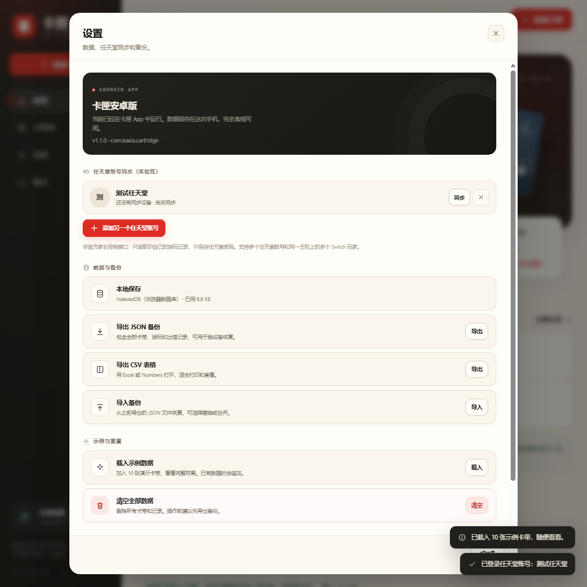
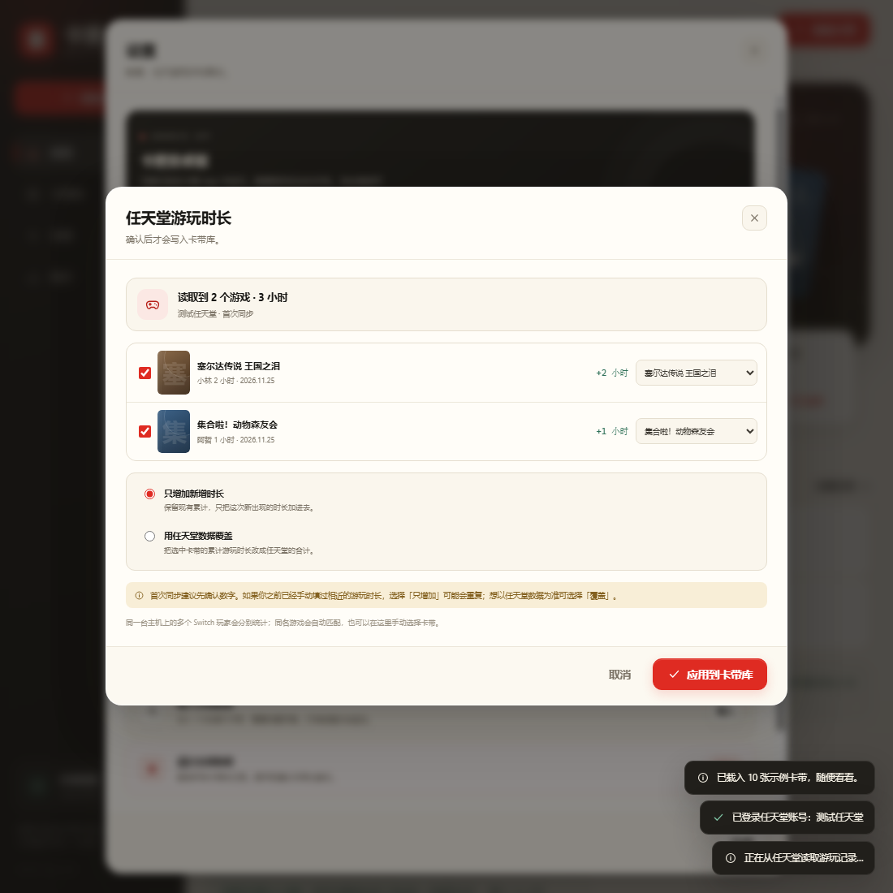
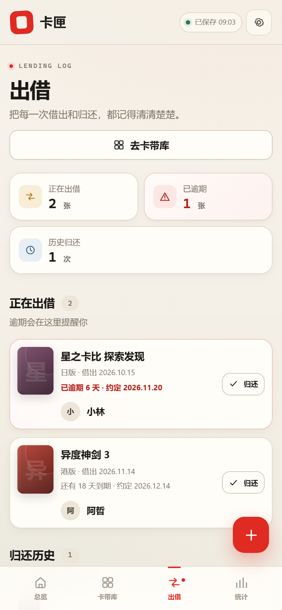

# 卡匣 · Switch 卡带管家

一个中文、移动端优先的 **Nintendo Switch 卡带收藏管理 App**。

提供两种形态：

- **Android APK**：直接安装到安卓手机，完全离线，不需要浏览器。
- **PWA / Web**：浏览器打开，也可以“添加到主屏幕”。

记录每张卡带的购入时间、价格、游玩时长和出借历史。  
**1.2.7**：任天堂账号同步新增详细教程与常见错误说明；卡带详情和列表缩略图不再重复显示游戏名，并继续修复任天堂同步接口版本/404 提示。全地区识别、NS1 / NS2 平台支持、实物多图和暂无归还时间继续保留。

## 直接安装 APK

安装包：

**[卡匣-1.2.7.apk](https://github.com/XiaoHongzhe/kaxia/releases/tag/v1.2.7)**（约 47.8 MB，内置离线 OCR 模型）

1. 用数据线、微信文件传输或其他方式，把 APK 传到安卓手机；
2. 在手机上点开 APK；
3. 如果系统提示“禁止安装未知来源应用”，允许当前文件管理器 / 浏览器安装；
4. 安装完成后，桌面会出现红色“卡匣”图标。

安装要求：**Android 7.0 及以上**。  
这是个人签名版本，不是应用商店包；系统可能提示“未知开发者”，确认继续即可。

SHA-256：

~~~text
7147967df29a711ebfe0ba45755ef03a4d9604695bc6fcd9cf2a6a4a26227cb2
~~~

首次打开是空白卡带库，可以点「先看看示例」载入 10 张演示卡带。

安装步骤、覆盖升级和校验信息：[安装说明](dist/安装说明.txt)  
版本变化：[更新日志](CHANGELOG.md) · [纯文本版](dist/更新日志.txt)

## 版本识别 / 实物图片 / 暂无归还时间

### 版本图片识别

- 在添加 / 编辑卡带的「版本」栏点「识别」，选择卡带盒或标签照片；
- App 用设备本地的 ML Kit 识别拉丁文字，再根据地区码和分级标识判断版本：<code>HKG</code> 港版、<code>JPN / CERO</code> 日版、<code>USA / ESRB</code> 美版、<code>EUR / PEGI</code> 欧版、<code>TWN / NCC</code> 台版、<code>CHN / TENCENT</code> 国行，以及韩版、澳版、亚洲版；
- 识别结果会填入版本栏，你仍可以手动修改；
- 版本栏支持手动输入，并去掉了「其他」选项；
- 识别在手机本地完成，图片不会上传。

识别只作为辅助，包装上的小字、反光和拍摄角度都会影响结果，请以卡带实物为准。没有识别出来时，会显示识别文字并提供不同版本的快捷选择。

### 卡带实物图片

- 每张卡带最多保存 **12 张**实物图片；
- 标签：卡带盒、正面、背面、侧面、划痕、其他；
- 适合记录卡带盒压痕、封面折痕、卡带正反面和侧面划痕；
- 图片会压缩后保存在本机，不上传；
- 入口：卡带详情 → 卡带状态 → 添加 / 管理图片。

### 平台支持

每张卡带可以标记：

- **仅 NS1**：只在 Switch 1 上使用；
- **NS1 / NS2 通用**：同时支持 Switch 1 和 Switch 2；
- **仅 NS2**：Switch 2 专用。

卡片底部、卡带详情和 CSV 导出都会带上平台支持；卡带库顶部新增「全部平台」筛选。旧数据没有这个字段时默认按「仅 NS1」处理。

### 出借暂无归还时间

登记出借时，约定归还日期下方新增「暂无归还时间」勾选项。勾选后不填写日期，出借卡片和详情会显示「暂无归还时间」，不会产生逾期提醒。

## 任天堂游玩时长同步（实验性）

设置页现在有「任天堂账号同步」：

1. 点「登录任天堂账号」，在 App 内打开任天堂官方登录页；
2. 登录并选择要授权的账号；
3. 回到卡匣后点「同步」；
4. 预览读取到的游戏、玩家和时长；
5. 选择「只增加新增时长」或「用任天堂数据覆盖」，确认后写入。

### 前提

- Switch 主机上已经开启 **家长控制**，并且用 Nintendo Switch Parental Controls App 绑定过这台主机；
- 不需要 Nintendo Switch Online 会员；
- 同步读取的是**家长控制记录的每日游玩时长**，不是任天堂账号的完整历史总时长。

### 支持多用户

- 可以绑定多个任天堂账号；
- 同一台主机上的多个 Switch 玩家会分别统计（来自每日汇总的 <code>devicePlayers</code>）；
- 预览里会显示每个玩家贡献的时长；
- 同一个设备/日期/玩家/游戏的记录会去重，重复同步不会重复累加。

### 安全与隐私

- 登录走 Nintendo Account 的 **PKCE** 流程；
- 任天堂密码只输入在任天堂官方页面里，App 不读取、不保存；
- 授权得到的 <code>session_token</code> 用 Android Keystore 的 AES-GCM 密钥加密后保存在本机；
- <code>session_token</code> 不会返回给 JavaScript，也不会写进 JSON 备份；
- 可以随时在设置里「解除绑定」。

> 这是**非官方接口**，使用的是 Nintendo Switch Parental Controls App 的私有 API。任天堂随时可能修改协议导致失效；仅用于读取自己的账号数据，请自行评估账号/ToS 风险。  
> 同步是手动的，不会在后台自动上传或修改数据；每次写入前都有预览确认。

## 功能

- **卡带库**：手动添加、编辑、删除卡带，支持网格 / 列表视图。
- **购买记录**：购入日期、价格、渠道、版本、成色、标签和备注；版本支持图片识别和手动输入。
- **游玩时长**：可手动填写累计时长，也可以按次记录「今天玩了多久」，自动累加。
- **任天堂同步**：登录任天堂账号，读取家长控制每日游玩时长；支持多账号、多玩家；预览后合并或覆盖。
- **出借管理**：借给谁、联系方式、借出日期、约定归还日期（支持“暂无”）、备注；登记归还后保留完整历史。
- **逾期提醒**：出借页和卡带库会标出已逾期的卡带。
- **搜索与筛选**：按名称、副标题、标签、备注、借出人搜索；按在库 / 已出借 / 逾期、版本筛选。
- **统计**：年度购入花费、游玩时长排行、版本分布、平均单价、每小时成本等。
- **版本识别**：选择卡带盒照片，本地识别港版 / 日版 / 美版 / 欧版 / 台版 / 国行 / 韩版 / 澳版 / 亚洲版；识别不准时可手动输入。
- **平台支持**：可标记仅 NS1、NS1 / NS2 通用或仅 NS2；卡片和详情会显示，卡带库可按平台筛选。
- **实物图片**：每张卡带最多 12 张，分类保存卡带盒、正反面、侧面和划痕。
- **封面**：可以上传本地图片（压缩后保存）或粘贴图片链接；不填则自动生成排版封面。
- **数据备份**：导出 JSON / CSV；在安卓 App 中会打开系统分享面板，可保存到文件、网盘或发给电脑。
- **离线使用**：APK 内置全部页面和资源，断网也能使用；任天堂同步需要联网。
- **返回键适配**：优先关闭弹窗 / 详情页，再返回总览；在总览再按一次退出。

  
  

## 数据保存在哪里

- APK 中的数据保存在 Android WebView 的 **IndexedDB** 中（数据库名 <code>kaxia-db</code>）。
- 任天堂授权 token 保存在 Android 原生加密存储，不在 IndexedDB，也不在导出的 JSON 里。
- 数据不上传服务器，不需要账号（任天堂账号仅用于读取游玩时长）。
- 卸载 App、清除应用数据会删除记录；换手机请先用「设置 → 导出 JSON」备份。
- 导入备份：设置 → 导入 → 选择 JSON，可选“合并导入”或“替换全部”。
- 换手机后需要重新登录任天堂账号；JSON 备份不包含 token。

> 目前**不做手机和电脑自动同步**，每个设备的数据独立。

## 在电脑上运行 Web 版

需要 Python 3（只用于启动本地静态服务）。

1. 双击 **启动卡匣.bat**；
2. 浏览器自动打开 <http://127.0.0.1:8765/>；
3. 也可以直接双击 <code>index.html</code>，但建议用本地服务器。

Web 版不包含任天堂原生同步功能（浏览器无法安全保存原生 token，也受 CORS 限制）；其他功能一致。

## 本地 GitHub 发布工具

项目里带有本地发布脚本，token 不写在源码里：

- token 使用 Windows DPAPI 加密，只有当前 Windows 用户能解密；
- 保存位置：<code>%LOCALAPPDATA%\Kaxia\github-token.dpapi</code>；
- 发布脚本：<code>scripts\github-publish.ps1</code>；
- 首次或更换 token：<code>scripts\set-github-token.ps1</code>。

用法：

~~~powershell
# 先看会改哪些文件，不联网上传
.\scripts\github-publish.ps1 -DryRun

# 上传源码
.\scripts\github-publish.ps1 -Message "docs: update README"

# 上传源码并创建 Release / 上传 APK
.\scripts\github-publish.ps1 -Message "release 1.2.8" -Apk "dist\卡匣-1.2.8.apk" -Tag "v1.2.8"
~~~

发布脚本会自动排除 `keystore.properties`、`kaxia-release.jks`、`node_modules`、构建产物和 APK（APK 走 Release）。

## 从源码重新打包 APK

需要：

- Node.js 22+
- pnpm
- JDK 21
- Android SDK Platform 36 / Build-Tools 36.0.0

~~~bash
pnpm install
pnpm cap:sync
cd android
.\gradlew assembleRelease
~~~

生成路径：

~~~text
android/app/build/outputs/apk/release/app-release.apk
~~~

签名配置在 <code>android/keystore.properties</code>，密钥在 <code>android/kaxia-release.jks</code>。这是个人自用签名，请勿公开，否则别人可以冒充更新。  
如果只需要调试包，可以运行 <code>.\gradlew assembleDebug</code>。

## 原生代码

任天堂同步是一个 Capacitor 原生插件：

~~~text
android/app/src/main/java/com/kaxia/cartridge/
├─ MainActivity.java          # 注册 NintendoPlugin
├─ NintendoPlugin.java        # 暴露 listAccounts / addAccount / removeAccount / sync
├─ NintendoAuthActivity.java  # App 内 WebView 登录，拦截回调
├─ NintendoApiClient.java     # PKCE、token 刷新、家长控制 API、玩家/日报解析
├─ NintendoStore.java         # Android Keystore AES-GCM 加密保存 token
└─ RegionScannerPlugin.java   # ML Kit 本地文字识别（版本图片）
~~~

## GitHub 调研

在动手前对比了 20 多个相关仓库，比较接近的几个：

| 项目 | 技术 | 购买/游玩 | 出借 | 中文 / 手机 |
|---|---|---|---|---|
| [kd0zero/switch-room](https://github.com/kd0zero/switch-room) | Python Flask | ✅ 日期、价格、游玩 | ❌ | 中文，响应式网页，非 PWA |
| [jamesmontemagno/switch-library](https://github.com/jamesmontemagno/switch-library) | React + Vite PWA | 只有购入日期 | 只有状态，无借出人/期限/历史 | 英文，PWA |
| [mstrlargo/vgc-shelf](https://github.com/mstrlargo/vgc-shelf) | Next.js + PostgreSQL | 有收藏价值 | ✅ 借出、归还、到期 | 英文，Docker 自托管，偏重 |
| [wwwescape/VideoGameTrackarr](https://github.com/wwwescape/VideoGameTrackarr) | Python + React | ✅ 价格、游玩记录 | ❌ | 英文，Docker 自托管，功能很全 |
| [alexsmbaratti/Pixel-Shelf](https://github.com/alexsmbaratti/Pixel-Shelf) | Node/Express | 有成本统计 | ❌ | 英文，2022 年后基本停更 |

**结论**：没有一个项目同时满足「中文 + 安卓 App + 购买价格 + 游玩时长 + 完整出借记录」。  
<code>switch-room</code> 最接近，但需要电脑跑 Flask，且没有出借；<code>switch-library</code> 的移动端体验好，但字段不够。因此这里做了一个更贴合需求的版本，并用 Capacitor 打包成安卓 App。

任天堂非官方接口的协议细节参考了 [nxapi](https://github.com/samuelthomas2774/nxapi)（AGPL-3.0）和 [switch-room](https://github.com/kd0zero/switch-room)（MIT）的公开实现；本项目未直接复制其代码。

## 文件结构

~~~text
ns/
├─ dist/
│  ├─ 卡匣-1.2.7.apk        # 安卓安装包（GitHub Release 下载）
│  ├─ 安装说明.txt
│  ├─ 更新日志.txt
│  └─ SHA256.txt
├─ android/                 # Capacitor 安卓工程 + 原生同步插件
├─ resources/               # 图标与启动图源文件
├─ index.html               # Web / PWA 入口
├─ assets/
│  ├─ app.js                # 全部交互、视图、IndexedDB 数据层
│  ├─ styles.css
│  ├─ icon-*.png
│  └─ favicon.svg
├─ manifest.webmanifest
├─ sw.js                    # Web 版 Service Worker
├─ server.py                # 零依赖本地静态服务器
├─ capacitor.config.json
├─ package.json
├─ 启动卡匣.bat
├─ README.md
├─ CHANGELOG.md            # 版本更新日志
└─ screenshots/
~~~

## 已知限制

- 不上架应用商店；APK 通过文件侧载安装。
- 任天堂同步是非官方接口，可能失效；需要主机已开启家长控制。
- 版本图片识别是辅助功能，依赖包装印刷文字和拍摄质量；识别失败时请手动输入。
- 实物图片会占用较多本地存储；每张卡带最多 12 张。
- 同步是手动的，不会后台自动同步，也不会自动修改已有记录。
- 不做账号和跨设备同步；任天堂 token 不进入备份。
- Android 返回键已适配，但没有桌面小组件、通知提醒。
- 上传封面会压缩到约 800px 宽，并占用 App 本地存储空间。
- 清除应用数据会删除卡带记录，务必定期导出备份。
